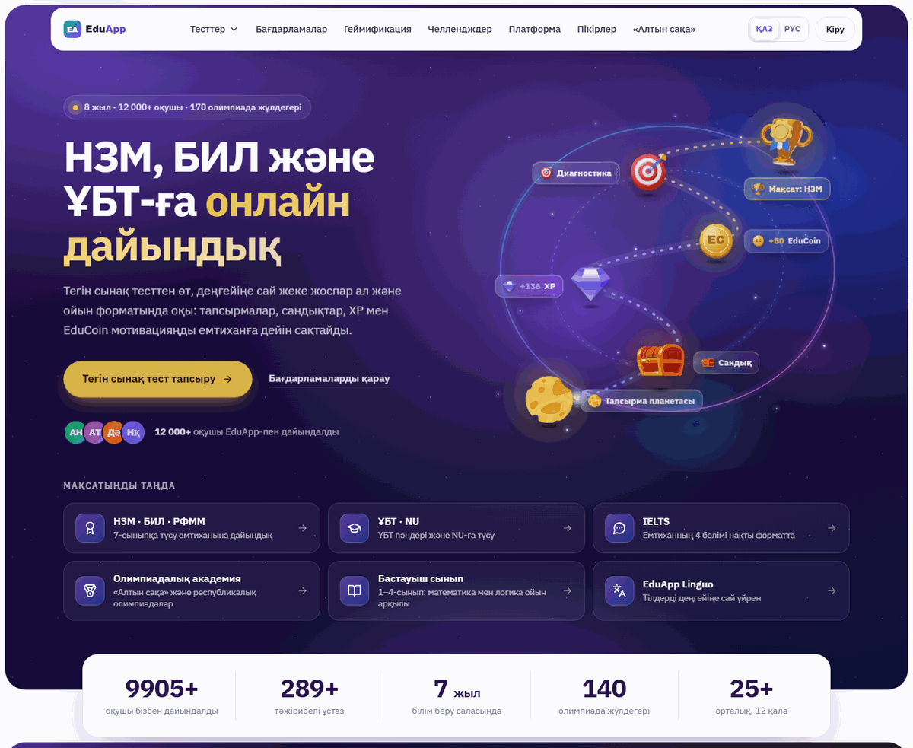

# EduApp App — gamified EdTech home page relaunch (zero-dependency static build)

A redesigned, SEO-friendly home page and test-catalog page for a gamified learning platform (planets, chests, XP, coins). Plain HTML/CSS/JS with a tiny Node build script that renders Kazakh and Russian pages from one template — no framework, no npm dependencies.



## Features

- **One template → two languages** — `build.mjs` renders `src/template.html` with `src/i18n/kk.json` / `ru.json` into `/` and `/ru/`; every translated node is tagged (`data-i18n*`), so the KZ ⇄ RU switch also works instantly on the client without reload.
- **Pre-rendered test catalog** (`/tests/`, `/ru/tests/`) — the same rendering code (`assets/tests.js`) runs in Node via `vm` at build time and in the browser at runtime: packages → sections → tests, subject/grade filters, search, URL hash state.
- **"Free trial test" modal** — format → subject → 8-question test → result with weak topics and next step (`assets/trial.js`).
- **Animated "learning orbit" hero map** (SVG + CSS), galaxy background, 3D tilt, spotlight, twinkling stars (`assets/fx.js`, reusable as a Vue directive); animations pause while scrolling and off-screen for smooth performance on weak laptops.
- Gamification showcase, programs popularity list, challenges, study formats, personal-cabinet demo (shop, coins, tests), reviews, FAQ, sticky mobile CTA, back-to-top with progress ring.
- **SEO** — hreflang, canonical, Open Graph, JSON-LD (`EducationalOrganization`, `WebSite`, `ItemList` of courses, `FAQPage`, breadcrumbs). See `docs/relaunch-plan.ru.md` for the SEO matrix and UX flows.
- Respects `prefers-reduced-motion`; no heavy `backdrop-filter`.

## Tech stack

HTML5 · CSS (custom properties, container queries, `@property`) · vanilla JavaScript · Node.js 18+ build script (`node:fs`, `node:vm`) · Python no-cache static server for preview.

## Project structure

```
build.mjs                     static site generator (template + i18n → dist/)
src/template.html             home page template (shared by kk/ru)
src/tests.html                test catalog page template
src/partials/                 sprite (SVG icons), header, footer, tail
src/i18n/kk.json, ru.json     all texts
src/tests-data.json           catalog data — RANDOM demo data
assets/                       site.css/js, fx.css/js, trial.css/js, tests.css/js, images → dist/lp/
assets/tests/                 generated section icons
tools/generate-demo-catalog.mjs   generates the random catalog + icons
tools/scrape-tests.mjs        (reference) scraper that snapshots a real catalog; points to a placeholder domain
docs/developer-notes.ru.md    developer notes: customization, deploy next to an SPA (nginx), effects API (RU)
docs/relaunch-plan.ru.md      relaunch plan: SEO matrix, bilingual setup, HTML structure, UX flows (RU)
serve.py / serve.bat          local no-cache server for dist/
```

## How to run (demo mode)

No dependencies to install, everything is offline.

```bash
node build.mjs                 # → dist/index.html, dist/ru/, dist/tests/, dist/ru/tests/, dist/lp/
python serve.py 8000           # → http://localhost:8000
# or just open dist/index.html in a browser

node tools/generate-demo-catalog.mjs --seed 7   # regenerate the random test catalog
```

> All data in this repository is randomly generated; brand names are anonymized. "EduApp", its logo, coin, people, reviews, statistics, prices, addresses and contacts are fictional. Exam/olympiad names (НЗМ, БИЛ, РФММ, ҰБТ, «Алтын сақа») are public.

## Қысқаша (KZ)

Ойын элементтері бар (планеталар, сандықтар, XP, монеталар) білім платформасының жаңа басты беті.
Фреймворксыз: таза HTML/CSS/JS және бір шаблоннан қазақша мен орысша беттерді жасайтын шағын Node-скрипт.
Тесттер каталогы, тегін сынақ тест терезесі, анимацияланған «оқу орбитасы» картасы бар.
Іске қосу: `node build.mjs`, кейін `python serve.py`. Барлық деректер кездейсоқ, бренд атаулары өзгертілген.
